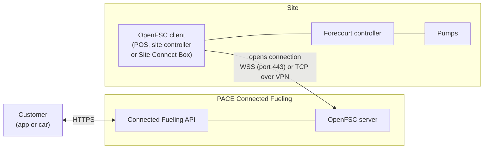
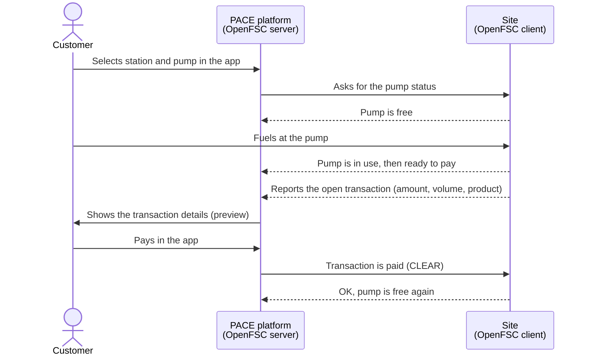
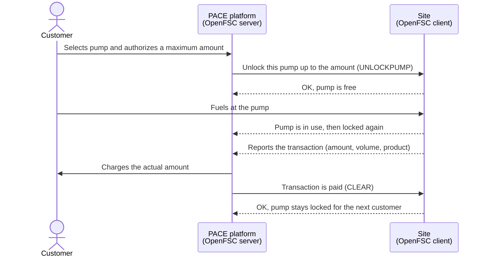
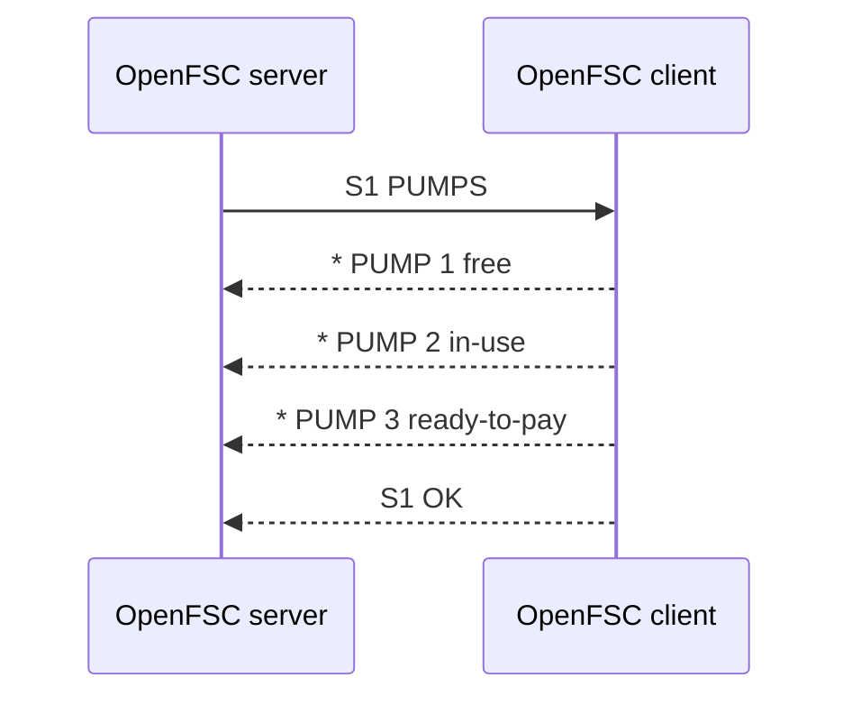

# OpenFSC Client Implementation Walkthrough
## Overview: How Connected Fueling Works

This overview explains the big picture before you write any code: who is involved, what the customer does at the pump, and how the messages between your site and the OpenFSC server are structured. If you already know POS and forecourt systems but are new to OpenFSC, start here.

In this overview:

- [What Connected Fueling Is](#what-connected-fueling-is)
- [The Parties](#the-parties)
- [Post-Pay and Pre-Auth from the Customer's Point of View](#post-pay-and-pre-auth-from-the-customers-point-of-view)
- [How Messages Work](#how-messages-work)
- [Glossary](#glossary)

---

## What Connected Fueling Is

Connected Fueling lets customers pay for fuel with a mobile app (or the infotainment system in their car) while they stay on the forecourt. They don't need to go into the shop, and the site doesn't need an outdoor payment terminal.

OpenFSC (short for Fueling Site Connect) is the protocol that connects your site to PACE's Connected Fueling platform. Through OpenFSC, your site reports products, prices, pump statuses and open transactions, and the platform tells your site when a transaction has been paid or when a pump should be unlocked.

Payment itself is not part of OpenFSC. The platform handles the payment with the customer and the payment provider, and only tells your site the result.

---

## The Parties

| Party | Role |
|---|---|
| **Customer** | Uses an app (for example PACE Drive, a fleet card provider's app, or an in-car system) to select a pump and pay. |
| **Connected Fueling platform (PACE)** | Runs the **OpenFSC server**. Connects the apps with the sites and handles payment. |
| **Site** | The fuel station. A POS, a site controller, Site Connect software or a Site Connect Box at the site runs the **OpenFSC client**. |
| **Pumps** | Controlled by your forecourt controller or POS as usual. OpenFSC never talks to a pump directly. |



Your site is always the **client**. It opens the connection to the OpenFSC server and keeps it open. This means the site needs no inbound firewall rules: only an outbound connection over secure WebSockets on port 443, or a TCP connection through a VPN.

Once the connection is open, both sides can send messages at any time. Most of the traffic is the server asking your client for data (prices, pump statuses, transactions) and your client sending updates when something changes at the site.

---

## Post-Pay and Pre-Auth from the Customer's Point of View

OpenFSC supports the two payment processes you already know from the forecourt. Your site may support one or both.

### Post-Pay: Fuel First, Then Pay in the App

Post-Pay is the most common process in Germany. It works like paying at the shop counter, except that the customer pays in the app instead.

1. The customer arrives, opens the app and selects the pump.
2. The customer fuels as usual.
3. When the nozzle is hung up, the app shows the amount to pay.
4. The customer pays in the app.
5. The site marks the transaction as paid and releases the pump.



### Pre-Auth: Authorize First, Then Fuel

Pre-Auth is common outside Germany and at unmanned stations. It works like an outdoor payment terminal: the amount is reserved before the pump is released.

1. The customer selects the pump in the app and authorizes a maximum amount.
2. The platform asks the site to unlock the pump for that customer.
3. The customer fuels.
4. The site reports the actual amount, and the platform charges only that amount.
5. If the customer doesn't fuel at all, the site cancels the session instead.



Part 3 explains both processes in detail, including cancellations and error cases.

---

## How Messages Work

OpenFSC is a plain-text protocol. Each message is one line of text, for example:

```
S1 PUMPSTATUS 3
```

The first word is the **tag**, the second is the **method**, and the rest are arguments. Part 1 describes the exact format.

There are three kinds of messages:

| Kind | Tag | Reply expected? | Example |
|---|---|---|---|
| **Request** | An identifier chosen by the sender, e.g. `S1` or `C1` | Yes: `OK` or `ERR` with the same tag | `S1 PUMPSTATUS 3` |
| **Response** | The tag of the request it answers | No | `S1 OK` or `S1 ERR 404 Pump unknown` |
| **Notification** | `*` | No | `* PUMP 3 free` |

Both sides can send requests. In practice, the server sends most of them (it asks for data or tells your client to do something), and your client mostly sends notifications.

A common pattern is a request answered by several notifications and a final `OK`:



The `OK` tells the server that all the data has been sent. You will see this pattern for products, prices, pumps and transactions.

---

## Glossary

| Term | Meaning |
|---|---|
| **Connected Fueling** | PACE's platform for paying for fuel in an app. Also the name used in reconciliation lists for transactions paid this way. |
| **OpenFSC** | Fueling Site Connect, the protocol between the site and the platform. |
| **OpenFSC server** | The platform side of the connection, operated by PACE. |
| **OpenFSC client** | The software at the site (POS, site controller or Site Connect Box) that connects to the OpenFSC server. This is what you build. |
| **Site** | A fuel station. Each site connects with its own credentials. |
| **Site Connect Box** | Dedicated hardware that runs the OpenFSC client at sites where the POS can't run it itself. |
| **SiteAccessKey and Secret** | The credentials a site uses to log in to the OpenFSC server. You receive them when the site is onboarded. |
| **Post-Pay** | The customer fuels first and pays afterward. |
| **Pre-Auth** | The customer authorizes a maximum amount before the pump is unlocked. |
| **SiteTransactionID** | The transaction ID your site reports. In Post-Pay it is your own POS transaction ID. In Pre-Auth it is the FSCTransactionID. |
| **FSCTransactionID** | The transaction ID assigned by the OpenFSC server. In Pre-Auth you receive it when the pump is unlocked. In Post-Pay you first see it when the transaction is cleared. |
| **CLEAR** | The server's message that a transaction has been paid, so your site can close it and release the pump. |
| **PaymentMethod** | The payment method the customer used, for example `pace` or `dkv`. Your site reports it in its reconciliation lists. |
| **MOC** | Mineral oil company, i.e. the fuel brand that receives the site's reconciliation lists. |

---

**Next:** [Part 1: Connection Handling](part-1.md)
