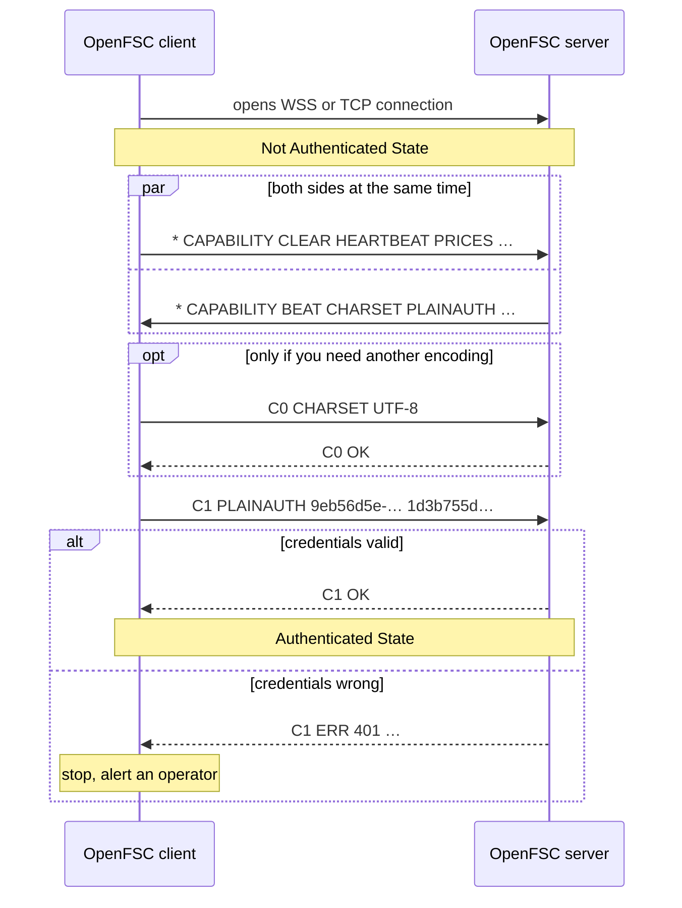
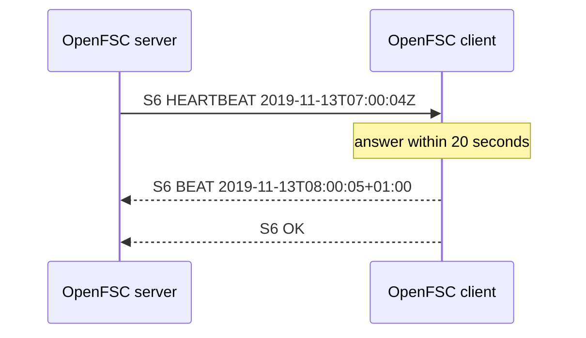
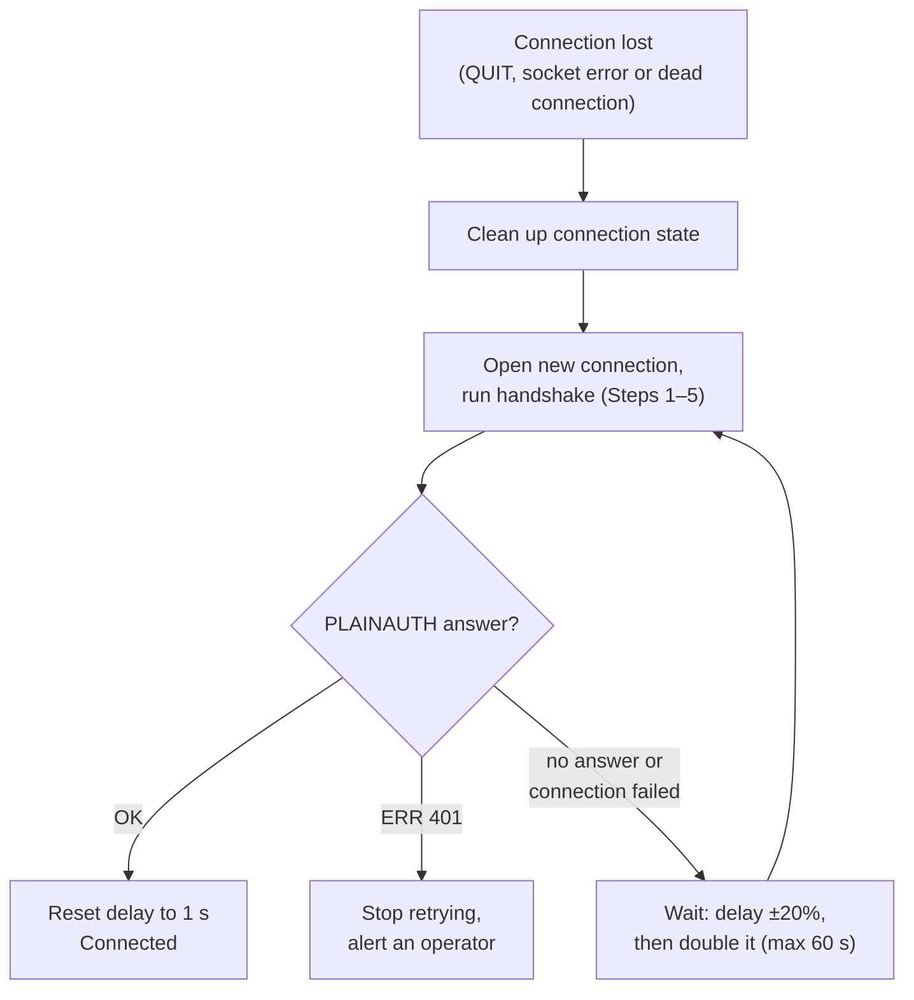
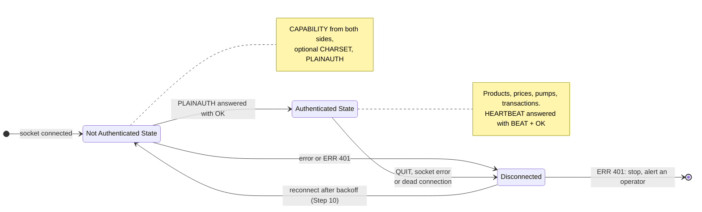

# OpenFSC Client Implementation Walkthrough
## Part 1: Connection Handling

This part takes you from opening the connection to the OpenFSC server to a stable, authenticated connection that answers heartbeats and reconnects on its own. If you are new to OpenFSC, read the [Overview](overview.md) first.

In this part:

- [Prerequisites](#prerequisites)
- [Step 1: Open a TCP/WebSocket Connection](#step-1-open-a-tcpwebsocket-connection)
- [Step 2: Understand the Message Format](#step-2-understand-the-message-format)
- [Step 3: Handle the CAPABILITY Exchange](#step-3-handle-the-capability-exchange)
- [Step 4: (Optional) Negotiate Character Encoding](#step-4-optional-negotiate-character-encoding)
- [Step 5: Authenticate with PLAINAUTH](#step-5-authenticate-with-plainauth)
- [Step 6: Implement a Tag Manager](#step-6-implement-a-tag-manager)
- [Step 7: Implement HEARTBEAT / BEAT](#step-7-implement-heartbeat--beat)
- [Step 8: Implement QUIT Handling](#step-8-implement-quit-handling)
- [Step 9: Handle Unknown and Error Messages Gracefully](#step-9-handle-unknown-and-error-messages-gracefully)
- [Step 10: Reconnect Robustly](#step-10-reconnect-robustly)
- [Connection State Summary](#connection-state-summary)

---

## Prerequisites

Before writing any code, make sure you have the following on hand:

- **SiteAccessKey** (a UUID) and **Secret**: the site's credentials for logging in to the OpenFSC server. You receive them when the site is onboarded.
- **Server address and port**: the OpenFSC server hostname, and either port 443 (WSS/TLS) or the TCP port reachable through the VPN.
- **Connection type**: secure WebSockets (WSS) or plain TCP through a VPN. This choice only affects how you open the connection. The protocol on top is the same for both, and that is what this walkthrough covers.

---

## Step 1: Open a TCP/WebSocket Connection

Open a long-lived connection to the OpenFSC server. The protocol needs a connection that delivers all bytes in order, which both WSS and TCP do.

- If using **WSS**: connect to `wss://<server>:443`. Handle TLS negotiation via your WebSocket library.
- If using **TCP over VPN**: open a raw TCP socket to the server's address and port.

Once the connection is open, you are in the **Not Authenticated State**. Until you have logged in (Step 5), you may only use the handshake methods.

> **Important:** If the connection drops for any reason, your client must reconnect and run the whole handshake again. Step 10 explains how.

---

## Step 2: Understand the Message Format

Every message in the protocol, sent or received, has this structure:

```
<tag> <method> <arg0> <arg1> ... <argN>
```

Key rules:
- Fields are separated by **single spaces**.
- Every message is terminated by **`\r\n`** (CRLF). Your parser must read until it finds `\r\n` to know a message is complete. In all examples throughout this walkthrough, the line break represents this terminator.
- The **tag** is either `*` (notification, no reply expected) or an alphanumeric identifier like `S1`, `C0` (request/response, a reply with the same tag is expected).
- The **method** is an uppercase alphanumeric word like `CAPABILITY`, `PUMPS`, etc.
- The default encoding is **ASCII**. You can switch to another encoding (e.g. UTF-8) during the handshake using `CHARSET`, but for a first implementation ASCII is fine.

Get your message parser right before anything else. A simple approach is a line reader that collects incoming bytes and hands over a complete message each time it finds `\r\n`.

---

## Step 3: Handle the CAPABILITY Exchange

Immediately after the connection is open, **both sides send a `CAPABILITY` notification simultaneously**, without waiting for the other. This is always the very first message from each party.

**What to send:**

```
* CAPABILITY CLEAR HEARTBEAT PRICES PUMPS PUMPSTATUS QUIT TRANSACTIONS
```

This tells the server which methods *your client* can handle, i.e. the requests and notifications the server may send to you. At minimum you must announce the methods you actually implement. For the connection phase, the relevant ones are:

- `HEARTBEAT`: your client handles heartbeat requests (and answers them with `BEAT`, see Step 7)
- `QUIT`: your client understands disconnect notifications

The remaining methods in the list (`CLEAR`, `PRICES`, `PUMPS`, `PUMPSTATUS`, `TRANSACTIONS`) are the server requests you will implement in Parts 2 and 3. As you implement more functionality, you will add the matching methods to this list: `PRODUCTS` in Part 2, `LOCKPUMP` and `UNLOCKPUMP` (Pre-Auth only) in Part 3 and `TRANSACTIONINFO` in Part 4.

> **Note:** `CAPABILITY` lists the methods the *sending* party handles. Methods your client *sends* (`CHARSET`, `PLAINAUTH`, `BEAT`, `PRICE`, `PUMP`, `TRANSACTION`, `LOCKEDPUMP`) belong to the server's list, not yours. Don't copy the server's list below into your own announcement.

**What to expect from the server:**

```
* CAPABILITY BEAT CHARSET PLAINAUTH PRICE PUMP TRANSACTION LOCKEDPUMP QUIT
```

Parse the server's capability list and store it. The server announces the methods *it* handles: `BEAT`, `CHARSET`, `PLAINAUTH`, `PRICE`, `PUMP`, `TRANSACTION`, `LOCKEDPUMP` and `QUIT`. In the future, you can use this to detect which optional features the server supports (for example `NEWSESSION` and `SESSIONS` if it supports Connection Multiplexing, see Part 4). Your client announces `HEARTBEAT` because it handles that request, so make sure it is in your list.

> `CAPABILITY` is a **Notification** (tag `*`), so neither side sends an `OK` or `ERR` in response. Just send it and move on.

---

## Step 4: (Optional) Negotiate Character Encoding

If you need to send or receive non-ASCII characters (e.g. fuel product names with umlauts), send a `CHARSET` request *before* authenticating:

```
C0 CHARSET UTF-8
```

The server will reply:

```
C0 OK
```

The tag `C0` is chosen by your client. It only needs to be unique while this request is open. A counter (C0, C1, C2, …) works well.

> **Caution:** The `OK` response itself is still in the *old* encoding. All messages *after* the `OK` use the new encoding.

If the encoding is not supported, the server replies with:
```
C0 ERR 404 Unknown encoding
```

If you stick to ASCII-only content, you can skip this step entirely for now.

---

## Step 5: Authenticate with PLAINAUTH

Now send your credentials to transition into the **Authenticated State**:

```
C1 PLAINAUTH <SiteAccessKey> <Secret>
```

For example:
```
C1 PLAINAUTH 9eb56d5e-6563-430a-9d39-5ddf567e73d5 1d3b755d3bce8f09b4f8ff08dabf1796
```

The server responds:

```
C1 OK
```

You are now authenticated. You may begin using all methods defined for the **Authenticated State**.

If authentication fails:
```
C1 ERR 401 SiteAccessKey and/or secret are not valid
```

In this case, check your credentials. Retrying with wrong credentials won't help: report the error and wait until an operator fixes the credentials.

### The Handshake at a Glance

Steps 1 to 5 together:



---

## Step 6: Implement a Tag Manager

Before going further, you need a reliable way to match requests and responses. Both sides can send requests at any time, so the server's requests and responses to your own requests can arrive mixed together.

A simple tag manager should:

1. **Generate unique tags** for outgoing requests (e.g. `C0`, `C1`, `C2`, …).
2. **Track your open requests**: store a mapping of `tag → callback/handler` so you can match an incoming `OK` or `ERR` to the request you sent.
3. **Answer server requests with their tag**: when the server sends a request (e.g. `S4 TRANSACTIONS`), your client must reply with the same tag (`S4 OK` or `S4 ERR ...`).

Keep client-originated tags and server-originated tags separate to avoid collisions (e.g. prefix yours with `C`, the server uses `S`).

---

## Step 7: Implement HEARTBEAT / BEAT

The server will periodically send a `HEARTBEAT` request. **You must respond within 20 seconds**, or the server will consider the connection unstable. By default, the server closes the connection with a `QUIT` after 3 unanswered heartbeats.

An incoming heartbeat looks like:
```
S6 HEARTBEAT 2019-11-13T07:00:04Z
```

Your client must respond with **two messages** in sequence, both using the same tag:

1. A `BEAT` notification with your current local timestamp in RFC-3339 format:
```
S6 BEAT 2019-11-13T08:00:05+01:00
```
2. An `OK` to conclude the request:
```
S6 OK
```



If the server's timestamp can't be parsed as RFC-3339, answer with `S6 ERR 422 Timestamp invalid` instead of `BEAT` and `OK`. This shouldn't happen with the PACE server, but it is the error code the spec defines for `HEARTBEAT`.

The `BEAT` message is only informational: it lets the server see how far your clock differs from its own. The `OK` is what completes the `HEARTBEAT` request.

Your implementation checklist for heartbeats:
- [ ] Parse incoming `HEARTBEAT` messages and extract the tag.
- [ ] Immediately reply with `BEAT` carrying your current timestamp (RFC-3339 with timezone offset).
- [ ] Follow up with `OK` using the same tag.
- [ ] Do this within 20 seconds. If your system is under load, give heartbeat handling a high priority.

---

## Step 8: Implement QUIT Handling

The server may send a `QUIT` notification at any time to signal it is about to disconnect:

```
* QUIT <reason message>
```

When you receive this, the server will drop the connection immediately after. Your client should:
1. Log the reason for diagnostics.
2. Close the connection cleanly on your side.
3. **Reconnect** and restart the handshake from Step 1, following the retry rules in Step 10.

Your client may also send `QUIT` before intentionally disconnecting:
```
* QUIT bye bye
```

This is optional (you may also just close the socket), but it is good practice.

---

## Step 9: Handle Unknown and Error Messages Gracefully

During development (and in production), you may receive methods you don't yet handle, or send requests that result in errors. Build these habits in early:

- **Unknown method received:** Reply with `ERR 405 Method unknown` using the incoming tag, then continue operating normally. Do not crash.
- **Bad request from your side:** If you receive `ERR 400 Bad request`, check the message you sent. Most likely the tag, an argument or the method name is malformed.
- **Wrong state error (`403`):** You sent an authenticated-state method before completing the handshake (or vice versa). Check your state machine.
- **Unexpected disconnect:** Always reconnect and restart the handshake (see Step 10).

---

## Step 10: Reconnect Robustly

The connection to the OpenFSC server should stay up all the time, so your client is always either connected or trying to reconnect. Getting this loop right matters as much as any single method.

### When to Reconnect

Reconnect whenever one of these happens:

- The server sends `QUIT` (Step 8).
- The socket is closed or reports an error.
- The connection looks dead, even though the socket still appears open (see below).

Reconnecting always means opening a **new** socket and running the full handshake again: `CAPABILITY`, optionally `CHARSET`, then `PLAINAUTH` (Steps 1–5). Nothing carries over from the previous connection.

### Detect Dead Connections

A TCP connection can break without either side noticing: a VPN tunnel or NAT gateway silently drops it, but neither socket reports an error (a so-called *half-open* connection). Your client then waits for messages that will never arrive. So don't rely on the socket alone to tell you the connection is gone.

- **Use transport-level keepalive.** Enable TCP keepalive on raw TCP sockets, or send WebSocket ping frames when using WSS, and close the connection if no response arrives within 30–60 seconds. This works regardless of how much protocol traffic is flowing and should be your primary mechanism.
- **Use the heartbeat as a fallback.** By default, the server sends a `HEARTBEAT` once it hasn't heard from your client for about a minute (this interval is server-side configuration, not part of the spec). So if **2 minutes** pass after your last outgoing message and nothing at all has arrived from the server, treat the connection as dead, close it and reconnect.

The heartbeat check has a limit: every message your client sends restarts the server's idle timer. A client that sends notifications often may never receive a `HEARTBEAT` at all. That is fine on a healthy connection, but it means the fallback can't detect a dead one. That's why transport-level keepalive comes first.

### Back Off Between Attempts

Reconnecting over and over without a pause while the server is unreachable wastes resources on both sides and can slow down recovery for everyone. Instead, wait a bit longer after each failed attempt (exponential backoff) and add some randomness (jitter):

1. Make the first reconnect attempt right away.
2. If it fails, wait 1 second before the next attempt, then 2, 4, 8, … seconds, capped at **60 seconds**.
3. Add a random ±20% to each delay so that many sites don't all reconnect at the same moment after a server restart.
4. Reset the delay only after `PLAINAUTH` has been answered with `OK`, not as soon as the socket opens. Otherwise a server that accepts connections and closes them right away would make your client reconnect without any pause.

The one exception is `ERR 401` on `PLAINAUTH` (Step 5): wrong credentials won't fix themselves, so stop retrying, report the error and wait for an operator.



### Clean Up Connection State

When a connection ends, discard everything that belonged to it:

- **Your open requests:** mark every entry in your tag manager (Step 6) as failed. No response for those tags will arrive. Don't simply resend them on the new connection: decide per request whether it is still needed.
- **Incoming requests you haven't answered yet:** drop them. The server tags (`S…`) belong to the old connection and must not be answered on the new one.
- **The line-reader buffer:** discard any partially received message.
- **Notifications that couldn't be sent:** don't queue and resend them. Notifications expect no reply, and the server asks for the current state after you reconnect.

### What to Expect After Reconnecting

Once you're authenticated again, the server asks for the current state of your site. Your client only needs to answer these requests as described in Parts 2 and 3:

1. `PRODUCTS`, if your client announced it (Part 2, Step 2).
2. `PRICES` (Part 2, Step 3).
3. A retried `CLEAR` for any transaction whose clearing was interrupted by the disconnect (Part 3, "Handling CLEAR After Reconnection").
4. `TRANSACTIONS` (Part 3, Step 2).

Pump statuses aren't requested on connect. The server asks for them via `PUMPS` or `PUMPSTATUS` when a customer needs them.

Your implementation checklist for reconnection:
- [ ] Reconnect on `QUIT`, on socket close/error, and when the connection looks dead.
- [ ] Enable TCP keepalive or WebSocket pings, and use the 2-minute heartbeat check as a fallback.
- [ ] Back off exponentially with jitter (1 s → 60 s cap), resetting only after a successful `PLAINAUTH`.
- [ ] Stop retrying on `ERR 401` and alert an operator.
- [ ] Fail pending requests, drop unanswered server requests and clear the read buffer on disconnect.
- [ ] After re-authentication, answer the server's `PRODUCTS`, `PRICES`, `CLEAR` and `TRANSACTIONS` requests.

---

## Connection State Summary

Here is the complete lifecycle of a connection:



---

## What's Next

With a stable, authenticated connection in place, Part 2 covers **products, prices and pump statuses**. Products and prices are the first things the server asks for after you log in.

**Previous:** [Overview](overview.md) · **Next:** [Part 2: Products, Prices & Pump Status](part-2.md)
