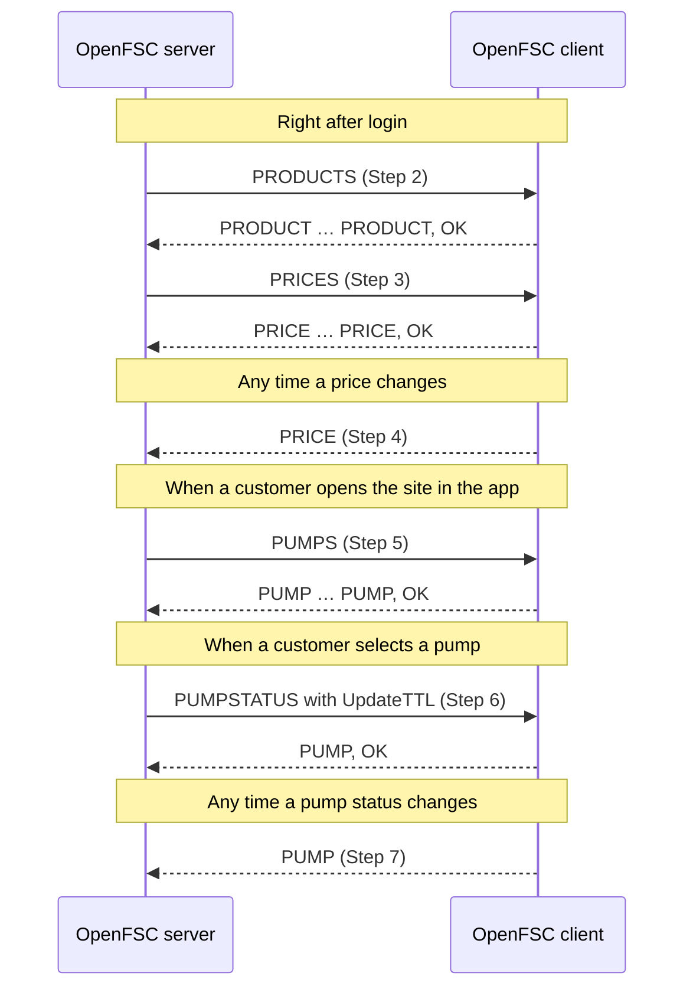
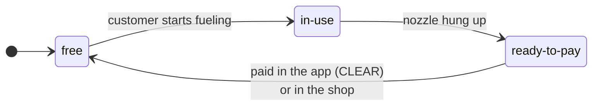
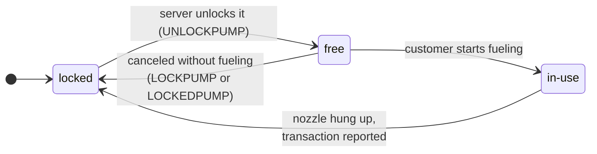
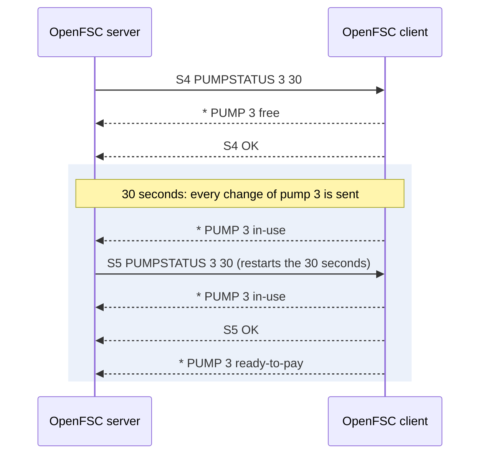

# OpenFSC Tutorial: From Zero to Hero
## Part 2: Products, Prices & Pump Status, or: Show Them What You've Got

Once your client is connected and logged in (Part 1), the server asks for your products and prices right away. It asks for pump statuses later, whenever a customer needs them. This part covers how to answer these requests, how to send changes without being asked, and how `UpdateTTL` asks your client to send status updates for a limited time. Think of it as setting up the shop window.

In this part:

- [Step 1: Understand the Notification Pattern](#step-1-understand-the-notification-pattern)
- [Step 2: Announce Products with PRODUCTS / PRODUCT](#step-2-announce-products-with-products--product)
- [Step 3: Implement PRICES](#step-3-implement-prices)
- [Step 4: Send Price Changes](#step-4-send-price-changes)
- [Step 5: Implement PUMPS](#step-5-implement-pumps)
- [Step 6: Implement PUMPSTATUS and UpdateTTL](#step-6-implement-pumpstatus-and-updatettl)
- [Step 7: Send Pump Status Changes](#step-7-send-pump-status-changes)
- [Step 8: Update Your CAPABILITY Announcement](#step-8-update-your-capability-announcement)
- [Checklist](#checklist)

The steps follow the order in which the server uses these methods:



---

## Step 1: Understand the Notification Pattern

All requests in this part follow the pattern from the [Overview](overview.md#how-messages-work): one request, answered with one notification per item (tag `*`), then `OK` with the server's tag. Send all notifications before the `OK`: the server treats the request as complete once the `OK` arrives.

---

## Step 2: Announce Products with PRODUCTS / PRODUCT

Before sending prices, you must tell the server which products you sell and what kind of fuel each one is, using the `PRODUCTS` / `PRODUCT` methods. This lets the server categorize your products correctly (e.g. as diesel, petrol, LPG), whatever your internal product IDs and names are. It also carries the **VAT rate** per product, which is needed for payment. Your POS may know a product as article 4711; the app needs to know it's diesel.

> Formally this is a protocol extension, but treat it as mandatory: it will become part of the standard requirements, and there is no other way to send VAT rates.

### How it Works

The server asks for `PRODUCTS` before it asks for `PRICES`, so that it knows which products the following `PRICE` notifications refer to.

The server sends a `PRODUCTS` request, and your client responds with one `PRODUCT` notification per product, followed by `OK`:

```
Server: S0 PRODUCTS
Client: * PRODUCT 0100 ron98 19.0
Client: * PRODUCT 0200 ron95e10 19.0 LTR
Client: * PRODUCT 0300 ron95e5 19.0
Client: * PRODUCT 0400 diesel 19.0
Client: S0 OK
```

### PRODUCT Arguments

| Argument | Example | Required | Notes |
|---|---|---|---|
| ProductID | `0100` | ✓ | Must match the IDs used in `PRICE` and `TRANSACTION` |
| Category | `ron98` | ✓ | Standardized product type (see table below) |
| VATRate | `19.0` | ✓ | VAT rate for this product in percent |
| Unit | `LTR` | optional | Required if OptionalName is provided |
| OptionalName | `Super Müller Diesel` | optional | Human-readable name; overrides the `Description` from `PRICE` if provided |

`Unit` may be sent without `OptionalName` (e.g. `PRODUCT 0200 ron95e10 19.0 LTR`), but `OptionalName` can only be sent together with `Unit`.

### Product Categories

Use one of the standardized categories, e.g. `ron95e10`, `diesel` or `lpg`. The full list of 23 categories is in the [Reference](reference.md#product-categories). Do not use the deprecated `careDiesel` and `syntheticDiesel`.

---

## Step 3: Implement PRICES

`PRICES` asks your client for the current price of every fuel product available at the site.

**Incoming request:**
```
S1 PRICES
```

**Your response: one `PRICE` notification per product, then `OK`:**
```
* PRICE 0100 LTR EUR 1.339 Super Plus
* PRICE 0200 LTR EUR 1.229 Super 95
* PRICE 0300 LTR EUR 1.499 Super 95 E5
* PRICE 0400 LTR EUR 1.459 Diesel
S1 OK
```

Send a `PRICE` for every product you announced with `PRODUCT`, using the same ProductIDs.

### PRICE Arguments Explained

Each `PRICE` notification has the following fields:

| Argument | Example | Notes |
|---|---|---|
| ProductID | `0100` | Your internal product identifier, as announced with `PRODUCT` |
| Unit | `LTR` | Always `LTR` (liters) for now |
| Currency | `EUR` | One of the supported currencies listed below |
| PricePerUnit | `1.339` | End-user price **including VAT**, per liter. At most 4 integer digits and 1 to 3 fractional digits; whole values need a fractional part (e.g. `589.0`, not `589`) |
| Description | `Super Plus` | Product name as shown to the customer. May contain spaces (see below) |

The supported currencies are listed in the spec's [Supported Currencies](https://github.com/pace/openfsc-spec/blob/master/1.0/openfsc-spec.md#416-supported-currencies) (4.1.6): `EUR`, `CHF`, `GBP`, `DKK`, `SEK`, `NOK`, `PLN`, `CZK`, `HUF`, `RON`, `ISK`, `RSD`, `MKD`, `MDL`, `UAH`, `TRY`, `BAM`, `ALL` (others on request).

**Use one currency per site:** send the same `Currency` in all `PRICE` and `TRANSACTION` messages of a site. The spec does not mandate this yet, but it is a strong recommendation and may become a requirement in a later spec version. (`UNLOCKPUMP` in Part 3 also carries a currency, but that one is set by the server.)

The description is the last argument and, unlike all other arguments, may contain spaces. Everything after `PricePerUnit` is the description.

---

## Step 4: Send Price Changes

Your client doesn't need to wait to be asked. Whenever a fuel price changes at your site, send a `PRICE` notification right away:

```
* PRICE 0200 LTR EUR 1.249 Super 95
```

This way, customers who check the app before arriving at the site always see current prices. Nobody likes a surprise at the pump.

---

## Step 5: Implement PUMPS

`PUMPS` is the server's way of asking for the current status of every pump at your site. The server typically sends it when a customer opens your site in the app.

**Incoming request:**
```
S2 PUMPS
```

**Your response: one `PUMP` notification per pump, then `OK`:**
```
* PUMP 1 free
* PUMP 2 out-of-order
* PUMP 3 in-use
* PUMP 4 ready-to-pay
S2 OK
```

### Pump Statuses

Pump numbers are integers from **1 to 99**.

Your POS system must map its internal pump states to one of these values:

| Status | Meaning |
|---|---|
| `free` | Pump is idle and available for use |
| `in-use` | Customer is currently fueling |
| `ready-to-pay` | Fueling complete, awaiting payment (Post-Pay) |
| `locked` | Pump is locked, which is the default status in the Pre-Auth workflow (a customer can reserve it in the app to start fueling) |
| `out-of-order` | Pump is not operational |

Think carefully about how each state in your POS maps to these. The most critical ones to get right are `ready-to-pay` (triggers payment flow in Post-Pay) and `locked` (indicates a Pre-Auth workflow).

The idle status also decides which process the app starts. When a customer selects a pump, the app looks at its status: a `locked` pump starts Pre-Auth (the app asks the customer to authorize an amount), a `free` pump starts Post-Pay (the app shows `free` or `in-use` and waits for `ready-to-pay`). So a Pre-Auth pump must report `locked` and a Post-Pay pump `free` whenever it is idle.

> The spec also lists an `in-transaction` status, but it is deprecated. Do not implement or send it.

The statuses a pump goes through depend on the flow. In Post-Pay, a pump rests in `free`:



In Pre-Auth, a pump rests in `locked` and is only `free` while it is unlocked for one customer:



In both flows, a pump can switch to `out-of-order` at any time and back once it works again. Part 3 explains the transaction side of both flows.

---

## Step 6: Implement PUMPSTATUS and UpdateTTL

`PUMPSTATUS` is the single-pump equivalent of `PUMPS`. The server uses it to ask about one specific pump, typically when a customer has selected it in the app.

The pump argument is a pump number from 1 to 99.

**Incoming request (basic):**
```
S3 PUMPSTATUS 3
```

**Your response:**
```
* PUMP 3 free
S3 OK
```

Errors to handle:
- If the pump number is unknown, reply with `ERR 404 Pump unknown` instead of `OK`.

### The UpdateTTL Subscription

`PUMPSTATUS` has an important optional second argument: `UpdateTTL` (time to live). It is a number of seconds. During this time, your client must **send a notification every time the status of that pump changes**. In plain words: "keep me posted on pump 3 for the next 30 seconds".

**Incoming request with TTL:**
```
S4 PUMPSTATUS 3 30
```

Your response works the same way: send the current status, then `OK`:
```
* PUMP 3 free
S4 OK
```

But now, for (at least) the next 30 seconds, if pump 3 changes state, you must send a notification:
```
* PUMP 3 in-use
* PUMP 3 ready-to-pay
```

These are notifications with the `*` tag that your client sends on its own. No `OK` is needed for them.



While the customer is on the fueling screen, the server may renew the request before the time runs out, as shown above.

Implementation notes:
- The valid TTL range is **30 to 300 seconds**. If the value is outside this range, reply with `ERR 416 UpdateTTL is too high or too low (valid range: 30 to 300, both inclusive)`.
- A new `PUMPSTATUS` request for the same pump restarts the timer.
- **Only send updates when the status actually changes.** Don't poll and send the same status repeatedly.
- Several pumps can have an active `UpdateTTL` at the same time, so track the timer per pump.

---

## Step 7: Send Pump Status Changes

As with prices, your client doesn't need to wait to be asked. Whenever a pump's status changes, send a `PUMP` notification, whether there is an active `UpdateTTL` or not:

```
* PUMP 3 in-use
```

This keeps the server's view of your forecourt up to date. The server uses this data to update what customers see in the app, so send these updates as soon as your POS detects the change.

---

## Step 8: Update Your CAPABILITY Announcement

Add `PRODUCTS` to the `CAPABILITY` you send in the handshake (Part 1, Step 3):

```
* CAPABILITY CLEAR HEARTBEAT PRICES PRODUCTS PUMPS PUMPSTATUS QUIT TRANSACTIONS
```

The server announces `PRODUCT` in its list, on top of the basic list from Part 1, because product mapping is an extension. All lists are in the [Reference](reference.md#capability-lists).

---

## Common Mistakes to Avoid

- **Sending `OK` before all notifications:** The server expects all `PRODUCT`, `PRICE` or `PUMP` notifications to arrive before the `OK`. Sending `OK` early may cause the server to act on incomplete data.
- **Prices for products that weren't announced:** every ProductID in `PRICE` must have been announced with `PRODUCT`, otherwise the server can't categorize it or apply the right VAT rate.
- **Forgetting the UpdateTTL timer:** If you acknowledge a `PUMPSTATUS` with a TTL but then never send status changes, the server will have an outdated view of that pump while the customer is fueling.
- **Treating the TTL as the end of status updates:** The TTL only guarantees updates during its window. Status changes (Step 7) are always sent, also before a `PUMPSTATUS` request arrives and after its TTL has elapsed.
- **Prices without VAT:** `PricePerUnit` in `PRICE` must always be the **end-user price including VAT**. Don't send the net price by mistake.

---

## Checklist

>  **Recap:** Products announced, prices sent, pumps reported, and every change pushed as it happens. The app can now show your site exactly as it is.

- [ ] Answer `PRODUCTS` with one `PRODUCT` per product (category and VAT rate), then `OK`.
- [ ] Answer `PRICES` with one `PRICE` per announced product (end-user price including VAT), then `OK`.
- [ ] Use one currency for all prices and transactions of a site.
- [ ] Send a `PRICE` notification as soon as a price changes.
- [ ] Map your POS pump states to `free`, `in-use`, `ready-to-pay`, `locked` and `out-of-order`; never send `in-transaction`.
- [ ] Answer `PUMPS` with one `PUMP` per pump, then `OK`.
- [ ] Answer `PUMPSTATUS` with exactly one `PUMP` for that pump, then `OK`; `ERR 404` for unknown pumps.
- [ ] Accept `UpdateTTL` from 30 to 300 seconds (`ERR 416` otherwise), track it per pump and restart it on a new request.
- [ ] Send a `PUMP` notification on every status change, with or without `UpdateTTL`.
- [ ] Add `PRODUCTS` to your `CAPABILITY`.

---

## Putting It Together: A Typical Exchange After Connecting

Here is what the first minutes after login typically look like (shortened to two products):

```
→ Client logs in (Part 1)

Server: S0 PRODUCTS
Client: * PRODUCT 0100 ron98 19.0
Client: * PRODUCT 0200 ron95e10 19.0
Client: S0 OK

Server: S1 PRICES
Client: * PRICE 0100 LTR EUR 1.339 Super Plus
Client: * PRICE 0200 LTR EUR 1.229 Super 95
Client: S1 OK

→ The price of Super 95 changes

Client: * PRICE 0200 LTR EUR 1.249 Super 95

→ A customer opens the site in the app

Server: S2 PUMPS
Client: * PUMP 1 in-use
Client: * PUMP 2 out-of-order
Client: * PUMP 3 free
Client: * PUMP 4 ready-to-pay
Client: S2 OK

→ Customer selects pump 3 in the app: the server checks the pump,
  then asks for updates while the customer is on the fueling screen

Server: S3 PUMPSTATUS 3
Client: * PUMP 3 free
Client: S3 OK

Server: S4 PUMPSTATUS 3 30
Client: * PUMP 3 free
Client: S4 OK

→ Customer begins fueling

Client: * PUMP 3 in-use

→ Customer finishes fueling

Client: * PUMP 3 ready-to-pay

→ Continue to Part 3: Transactions
```

---

## What's Next

>  **Next up:** With products, prices and pump statuses handled, the server has everything it needs to show your site to customers. Part 3 is where the money happens: how your client reports transactions for Post-Pay and Pre-Auth, and how the server tells it that a transaction has been paid.

**Previous:** [Part 1: Connection Handling](part-1.md) · **Next:** [Part 3: Transactions](part-3.md)
