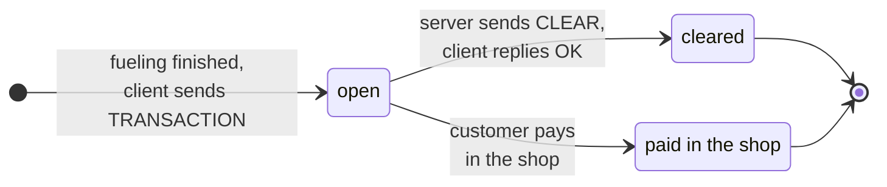
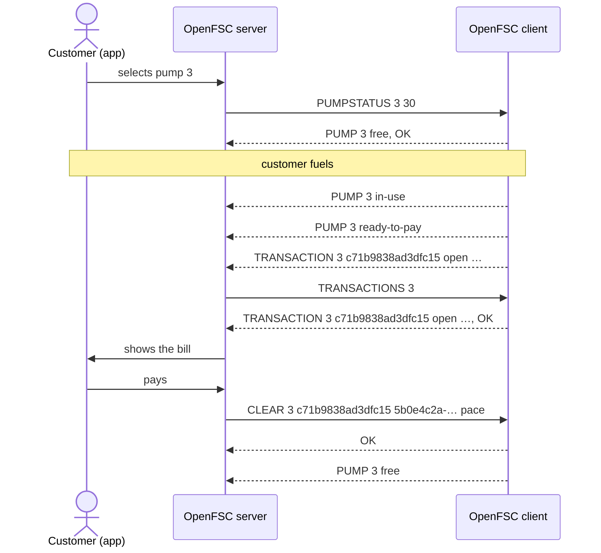
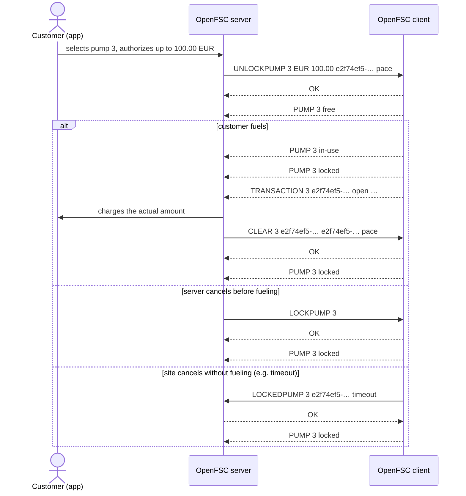
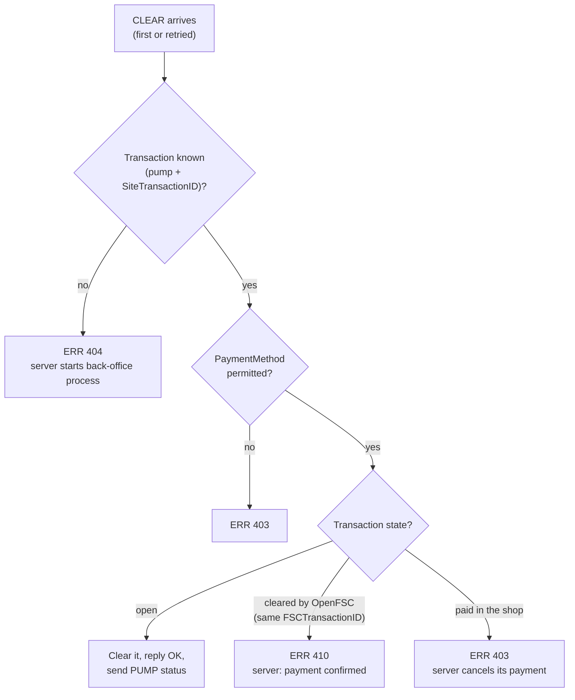

# OpenFSC Client Implementation Walkthrough
## Part 3: Transactions

This part is about turning fuelings into payments. It covers how your client reports transactions, how the server tells it that a transaction has been paid, and the two flows your client can support: **Post-Pay** and **Pre-Auth**.

In this part:

- [Step 1: Understand the Transaction Lifecycle](#step-1-understand-the-transaction-lifecycle)
- [Step 2: Implement TRANSACTIONS](#step-2-implement-transactions)
- [Step 3: Understand the TRANSACTION Notification Arguments](#step-3-understand-the-transaction-notification-arguments)
- [Step 4: The Post-Pay Flow](#step-4-the-post-pay-flow)
- [Step 5: The Pre-Auth Flow](#step-5-the-pre-auth-flow)
- [Step 6: Implement CLEAR](#step-6-implement-clear)
- [Step 7: Update Your CAPABILITY Announcement](#step-7-update-your-capability-announcement)
- [Checklist](#checklist)

---

## Step 1: Understand the Transaction Lifecycle

A transaction starts when the customer has finished fueling: in Post-Pay when the pump reaches `ready-to-pay`, in Pre-Auth when the pump returns to `locked`. From then on it is `open` until either:
- The server sends a `CLEAR` (paid via Connected Fueling), or
- The customer pays in the shop. In this case the transaction disappears from your POS and is no longer reported.



**One open transaction per pump.** A pump never has more than one open transaction. Connected Fueling does not support stacked sales: don't release a pump for the next customer while the previous transaction on it is still open. Many forecourt controllers allow stacking (often two unpaid sales per pump), so make sure it is disabled for pumps used with Connected Fueling.

Only `open` transactions are reported to the server. Cleared transactions and transactions paid in the shop are no longer reported, but your client must still know them for a while (see "Handling CLEAR After Reconnection" in Step 6).

> The spec also defines a `deferred` transaction status, meant for cases where an operator manually releases a pump with an unpaid transaction. It is not used in practice, so do not implement it.

> **Important:** Only send a `TRANSACTION` notification if fuel was actually dispensed (non-zero volume). A fueling with zero volume is not a transaction. In Post-Pay, the pump simply returns to `free`. In Pre-Auth, your client cancels the session with `LOCKEDPUMP` (Step 5).

---

## Step 2: Implement TRANSACTIONS

`TRANSACTIONS` works exactly like `PUMPS` and `PRICES` from Part 2: one request, answered with one notification per item. The server uses it in two situations:

- **Right after your client logs in**, to catch up on all transactions that are still unpaid.
- **When a pump reaches `ready-to-pay` in Post-Pay**, to show the customer the bill in the app. In this case it asks for that one pump (see below).

**Incoming request (all pumps):**
```
S4 TRANSACTIONS
```

**Your response: one `TRANSACTION` notification per open transaction, then `OK`:**
```
* TRANSACTION 3 c71b9838ad3dfc15 open 0100 EUR 86.83 72.97 19.0 13.86 LTR 64.85 1.339
S4 OK
```

If there are no open transactions, just send `OK` with no notifications:
```
S4 OK
```

### TRANSACTIONS for a Single Pump

The server may also ask for transactions on a specific pump only:

```
S4 TRANSACTIONS 2
```

Respond with only the transactions for that pump (or just `OK` if none), then `OK`. Reply with `ERR 404 Pump unknown` if the pump number is invalid.

### The UpdateTTL Subscription

Just like `PUMPSTATUS`, `TRANSACTIONS` supports an `UpdateTTL` argument, but only together with a pump number:

```
S4 TRANSACTIONS 3 60
```

After answering with the current transactions and `OK`, your client must send a `TRANSACTION` notification for that pump whenever a transaction changes during the TTL. The same TTL range applies: **30 to 300 seconds**. Respond with `ERR 416` if out of range.

---

## Step 3: Understand the TRANSACTION Notification Arguments

The `TRANSACTION` notification carries a lot of fields. Here is a breakdown:

| Position | Name | Example | Notes |
|---|---|---|---|
| arg0 | Pump | `3` | Pump number (1 to 99) |
| arg1 | SiteTransactionID | `c71b9838ad3dfc15` | Your POS-defined transaction ID (Post-Pay), or the FSCTransactionID provided by UNLOCKPUMP (Pre-Auth) |
| arg2 | Status | `open` | Always `open` |
| arg3 | ProductID | `0100` | Fuel product identifier |
| arg4 | Currency | `EUR` | One of the supported currencies (see Part 2, Step 3) |
| arg5 | PriceWithVAT | `86.83` | Total price including VAT |
| arg6 | PriceWithoutVAT | `72.97` | Total price excluding VAT |
| arg7 | VATRate | `19.0` | VAT percentage |
| arg8 | VATAmount | `13.86` | VAT amount (PriceWithVAT − PriceWithoutVAT) |
| arg9 | Unit | `LTR` | Always `LTR` |
| arg10 | Volume | `64.85` | Liters dispensed |
| arg11 | PricePerUnit | `1.339` | Price per liter including VAT. At most 4 integer digits and 1 to 3 fractional digits; whole values need a fractional part (e.g. `589.0`) |

Double-check your math before sending: `PriceWithoutVAT × (1 + VATRate/100)` should equal `PriceWithVAT`, `VATAmount` should equal `PriceWithVAT − PriceWithoutVAT`, and `Volume × PricePerUnit` should equal `PriceWithVAT`. Results must agree within one cent. Inconsistent values cause problems with the payment.

The **SiteTransactionID** differs between the flows. The Post-Pay and Pre-Auth steps below explain how.

---

## Step 4: The Post-Pay Flow

Post-Pay is the most common flow in Germany. The customer fuels first and pays afterward.

### Flow Overview



### Your Responsibilities

**1. When the pump reaches `ready-to-pay`:**

Proactively send a `PUMP` status notification (Part 2), and a `TRANSACTION` notification with status `open`. Use your own POS-generated transaction ID as `SiteTransactionID`:

```
* PUMP 3 ready-to-pay
* TRANSACTION 3 c71b9838ad3dfc15 open 0100 EUR 86.83 72.97 19.0 13.86 LTR 64.85 1.339
```

**2. Keep the pump blocked until the transaction is settled:**

The pump stays `ready-to-pay` until the server sends `CLEAR` or the customer pays in the shop. Don't release it for the next customer before that (no stacked sales, see Step 1).

**3. Keep reporting the transaction:**

When the server sends `TRANSACTIONS` (to show the bill, or after a reconnect), include all currently open transactions in your response, including this one.

**4. When the server sends `CLEAR`:**

See Step 6 below.

### Where the FSCTransactionID Comes From

In Post-Pay, the server creates its own transaction ID (the **FSCTransactionID**, a UUID) when the customer pays. Your client sees it for the first time in the `CLEAR` request, next to your own SiteTransactionID:

```
S5 CLEAR 3 c71b9838ad3dfc15 5b0e4c2a-9d1f-4e8b-a6c3-2f7d1e9b8a04 pace
```

Store it together with the transaction. You need it to recognize a retried `CLEAR` after a reconnect (Step 6). If your client receives `TRANSACTIONINFO` (Part 4), the same FSCTransactionID appears there just before the `CLEAR`.

---

## Step 5: The Pre-Auth Flow

Pre-Auth is common outside Germany and at unmanned sites. The customer authorizes a maximum amount before fueling, and the server then tells your client to unlock the pump.

### Flow Overview

A Pre-Auth pump rests in `locked`. It is only `free` while it is unlocked for one customer. After fueling it returns to `locked` (not `ready-to-pay`), and stays `locked` after the `CLEAR`.



Note that the FSCTransactionID (`e2f74ef5-…`) comes from `UNLOCKPUMP` and is then used everywhere: as SiteTransactionID in `TRANSACTION`, in `LOCKEDPUMP` and twice in `CLEAR`.

### Handling UNLOCKPUMP

The server sends `UNLOCKPUMP` to authorize fueling on a specific pump with a credit limit:

```
S5 UNLOCKPUMP 3 EUR 100.00 e2f74ef5-f427-4ae6-bdd3-70a96709992f pace
```

Arguments you need to handle:

| Argument | Example | Notes |
|---|---|---|
| Pump | `3` | Pump to unlock |
| Currency | `EUR` | Currency of the credit, one of the supported currencies (see Part 2, Step 3) |
| Credit | `100.00` | Maximum authorized amount |
| FSCTransactionID | `e2f74ef5-...` | Transaction ID assigned by the server. Store it, you'll need it later |
| PaymentMethod | `pace` | Payment method in use |
| ProductID1–8 | *(optional)* | If present, only unlock these specific nozzles |

**Your response:**

If the pump was successfully unlocked, reply:
```
S5 OK
```

Then update the pump status:
```
* PUMP 3 free
```

**Errors to return:**

| Code | Meaning |
|---|---|
| `403` | Payment method not permitted |
| `404` | Pump or ProductID unknown |
| `412` | Pump is in use: it was already unlocked or is currently used by someone else (e.g. a customer paying at the POS or with another payment method). The pump was not unlocked. |
| `422` | Currency unknown |

### Leaving Headroom for Pump Overrun

The `Credit` in `UNLOCKPUMP` is the maximum amount the customer has authorized. Many pumps do not stop the instant the preset limit is reached: valve closing time and hose pressure typically lead to a small overrun. If you preset the pump to exactly the `Credit`, the customer can end up with more fuel than was authorized.

We therefore recommend that you **preset the pump to a slightly lower limit than the `Credit`**. The `Credit` itself remains the authorized maximum; only the limit you program into the pump is reduced.

Two common approaches:

| Approach | Example (`Credit` 100.00) | Notes |
|---|---|---|
| Percentage | 2–3 % → pump limit 97.00–98.00 | Scales with the authorized amount. Recommended as the default. |
| Absolute amount | 1–2 EUR → pump limit 98.00–99.00 | Simple, but proportionally large for small credits. |

Guidelines:

- Choose the margin per site or pump type, based on how far your pumps typically overrun. Make it configurable.
- Make sure the reduced limit stays meaningful for small credits (for example, never reduce it to zero or below the pump's minimum preset). With an absolute margin, consider applying it only above a minimum credit.
- Only reduce the limit you send to the pump. Do not change anything in your `OK` reply to `UNLOCKPUMP`.
- Always report the amount actually dispensed in the `TRANSACTION` notification, even if the pump still overran and the total ended up above the margin you reserved.

### Using FSCTransactionID

In the Pre-Auth flow, you do **not** generate your own SiteTransactionID. Instead, use the `FSCTransactionID` provided by `UNLOCKPUMP` as the `SiteTransactionID` in your `TRANSACTION` notification:

```
* TRANSACTION 3 e2f74ef5-f427-4ae6-bdd3-70a96709992f open 0100 EUR 86.83 72.97 19.0 13.86 LTR 64.85 1.339
```

This is how the server links the authorized amount to the actual fueling.

### Handling LOCKPUMP (Server-Side Cancellation)

The server may cancel a Pre-Auth session before fueling begins by sending `LOCKPUMP`:

```
S6 LOCKPUMP 3
```

Cancel the pending authorization on your side and respond:
```
S6 OK
* PUMP 3 locked
```

Errors to return:

| Code | Meaning |
|---|---|
| `402` | Payment required: the pump can't be locked because a payment is pending |
| `404` | Pump unknown |
| `423` | Already locked |

### Handling LOCKEDPUMP (Client-Side Cancellation)

If no fuel was dispensed and *your* side needs to cancel the Pre-Auth session (for example after a timeout or a hardware problem), your client sends `LOCKEDPUMP`:

```
C7 LOCKEDPUMP 3 e2f74ef5-f427-4ae6-bdd3-70a96709992f aborted
```

The `Reason` argument must be one of:
- `aborted`: no fuel dispensed, e.g. the customer left
- `timeout`: the system canceled the session after a timeout

The server responds `OK` if it accepts the cancellation. Then send a pump status update to return the pump to its Pre-Auth idle state:

```
Server: C7 OK
Client: * PUMP 3 locked
```

Or the server returns one of these errors:

| Code | Meaning |
|---|---|
| `404` | Invalid transaction and/or pump combination |
| `403` | The transaction is in a state where it can't be canceled |
| `400` | Invalid reason |

> Remember: `LOCKEDPUMP` is only for the case where **no fuel was dispensed**. If fuel was dispensed, always send a `TRANSACTION` notification instead, even if the amount was very small.

---

## Step 6: Implement CLEAR

With `CLEAR`, the server tells your client that a transaction has been paid, so your client marks it as paid and releases the pump. `CLEAR` is used in both flows. Afterward, Post-Pay pumps return to `free` and Pre-Auth pumps return to `locked` (their idle state).

**Incoming request (Post-Pay example):**
```
S5 CLEAR 3 c71b9838ad3dfc15 5b0e4c2a-9d1f-4e8b-a6c3-2f7d1e9b8a04 pace
```

In Pre-Auth, SiteTransactionID and FSCTransactionID are the same, because your client reports the FSCTransactionID from `UNLOCKPUMP`:
```
S5 CLEAR 3 e2f74ef5-f427-4ae6-bdd3-70a96709992f e2f74ef5-f427-4ae6-bdd3-70a96709992f pace
```

Arguments:

| Argument | Example | Notes |
|---|---|---|
| Pump | `3` | Pump number |
| SiteTransactionID | `c71b9838ad3dfc15` | The transaction ID as reported by your client |
| FSCTransactionID | `5b0e4c2a-...` | The server's transaction ID. Store it with the transaction |
| PaymentMethod | `pace` | Payment method used |

**On success:**
1. Mark the transaction as cleared in your POS, and store the FSCTransactionID with it.
2. Reply `OK`.
3. Send a pump status update. The status to report depends on the flow:
   - **Post-Pay:** return the pump to `free`. It is now available for any customer.
   - **Pre-Auth:** return the pump to `locked`. This is the Pre-Auth idle state and shows that the pump is available for the next customer using the app.

```
S5 OK
* PUMP 3 free   ← Post-Pay
```
```
S5 OK
* PUMP 3 locked   ← Pre-Auth
```

**Important:** Mark cleared transactions in your reconciliation lists with "Clearance source: Connected Fueling" and the PaymentMethod used. The fuel brand (MOC) needs this to reconcile the site's transactions.

### CLEAR Error Handling

| Code | When to return | Meaning to the server |
|---|---|---|
| `404` | Pump and SiteTransactionID are unknown | The transaction is too old and your client no longer knows it → the server starts a manual back-office process |
| `403` | Payment method not permitted; or, on a retried `CLEAR`, the transaction was paid by other means (usually in the shop) | In the retry case the server cancels its payment transaction |
| `410` | Transaction not open, FSCTransactionID matches | The initial `CLEAR` was already processed successfully → transaction confirmed |

### Handling CLEAR After Reconnection

This is one of the harder edge cases. If the connection drops while your client is handling a `CLEAR`, the server doesn't know whether the `CLEAR` arrived. It therefore sends the `CLEAR` again after your client reconnects. Your client answers a retried `CLEAR` exactly like a first one, with the codes from the table above:



A 404 starts an expensive manual process, so keep cleared and shop-paid transactions (with their FSCTransactionID) in your POS for a while, e.g. 24 hours, so you can still answer a retried `CLEAR` with 410 or 403.

Build this logic into your `CLEAR` handler from the start.

---

## Step 7: Update Your CAPABILITY Announcement

For Post-Pay, the list from Part 2 is already complete. For Pre-Auth, add `LOCKPUMP` and `UNLOCKPUMP`:

```
* CAPABILITY CLEAR HEARTBEAT LOCKPUMP PRICES PRODUCTS PUMPS PUMPSTATUS QUIT TRANSACTIONS UNLOCKPUMP
```

See the [Reference](reference.md#capability-lists) for all lists.

---

## Complete Flow Examples

### Post-Pay (Full Example)

```
→ Authentication complete (Part 1)

Server: S0 PRODUCTS
Client: * PRODUCT 0100 ron98 19.0
Client: S0 OK

Server: S1 PRICES
Client: * PRICE 0100 LTR EUR 1.339 Super Plus
Client: S1 OK

Server: S2 PUMPS
Client: * PUMP 1 free
Client: * PUMP 2 free
Client: * PUMP 3 in-use
Client: * PUMP 4 ready-to-pay
Client: S2 OK

Server: S3 PUMPSTATUS 3 30
Client: * PUMP 3 in-use
Client: S3 OK

→ Customer finishes fueling on pump 3

Client: * PUMP 3 ready-to-pay
Client: * TRANSACTION 3 c71b9838ad3dfc15 open 0100 EUR 86.83 72.97 19.0 13.86 LTR 64.85 1.339

→ The app asks for the bill of pump 3

Server: S4 TRANSACTIONS 3
Client: * TRANSACTION 3 c71b9838ad3dfc15 open 0100 EUR 86.83 72.97 19.0 13.86 LTR 64.85 1.339
Client: S4 OK

→ Customer pays via app

Server: S5 CLEAR 3 c71b9838ad3dfc15 5b0e4c2a-9d1f-4e8b-a6c3-2f7d1e9b8a04 pace
Client: S5 OK
Client: * PUMP 3 free
```

### Pre-Auth (Full Example)

```
→ Authentication complete, pumps and prices exchanged

→ Customer pre-authorizes payment in app

Server: S1 UNLOCKPUMP 3 EUR 100.00 e2f74ef5-f427-4ae6-bdd3-70a96709992f pace
Client: S1 OK
Client: * PUMP 3 free

→ Customer starts fueling

Client: * PUMP 3 in-use

→ Customer finishes fueling

Client: * PUMP 3 locked
Client: * TRANSACTION 3 e2f74ef5-f427-4ae6-bdd3-70a96709992f open 0100 EUR 86.83 72.97 19.0 13.86 LTR 64.85 1.339

→ Server captures pre-authorized amount

Server: S2 CLEAR 3 e2f74ef5-f427-4ae6-bdd3-70a96709992f e2f74ef5-f427-4ae6-bdd3-70a96709992f pace
Client: S2 OK
Client: * PUMP 3 locked

---

→ Alternative: customer walks away without fueling, the site cancels the session

Server: S1 UNLOCKPUMP 3 EUR 100.00 e2f74ef5-f427-4ae6-bdd3-70a96709992f pace
Client: S1 OK
Client: * PUMP 3 free

Client: C2 LOCKEDPUMP 3 e2f74ef5-f427-4ae6-bdd3-70a96709992f aborted
Server: C2 OK
Client: * PUMP 3 locked
```

---

## Common Mistakes to Avoid

- **Using your own SiteTransactionID in Pre-Auth:** In Pre-Auth, the `SiteTransactionID` in your `TRANSACTION` notification must be the `FSCTransactionID` from `UNLOCKPUMP`. With a different ID, the server can't link the authorized amount to the transaction.
- **Stacking sales:** Releasing a pump for the next customer while its transaction is still open leads to two open transactions on one pump. This is not allowed, and the OpenFSC validator fails it.
- **Sending TRANSACTION for zero-volume fuelings:** If no fuel was dispensed, use `LOCKEDPUMP` instead.
- **Not handling the CLEAR retry after reconnect:** Implement all four `CLEAR` response cases (normal, 404, 403, 410) from day one.
- **Forgetting reconciliation marking:** Transactions cleared via OpenFSC must be flagged as such in your reconciliation lists. This is a requirement, not an option.
- **Sending LOCKEDPUMP when fuel was dispensed:** Even a tiny amount of dispensed fuel means a `TRANSACTION` must be reported. `LOCKEDPUMP` is strictly for zero-dispense cancellations.

---

## Checklist

- [ ] Report a transaction only if fuel was dispensed (volume above zero).
- [ ] Never have more than one open transaction per pump (no stacked sales).
- [ ] Answer `TRANSACTIONS` with all open transactions (or those of one pump), then `OK`; support `UpdateTTL` with a pump.
- [ ] Check the amounts: net + VAT = gross, volume × price per liter = gross, within one cent.
- [ ] Post-Pay: at `ready-to-pay`, send the `PUMP` status and the `TRANSACTION` with your own SiteTransactionID.
- [ ] Pre-Auth: handle `UNLOCKPUMP` (with its error codes) and preset the pump slightly below the `Credit`.
- [ ] Pre-Auth: use the FSCTransactionID from `UNLOCKPUMP` as SiteTransactionID.
- [ ] Pre-Auth: handle `LOCKPUMP`, and send `LOCKEDPUMP` when a session ends without fuel.
- [ ] Answer `CLEAR` with `OK`, then send the pump status (`free` for Post-Pay, `locked` for Pre-Auth).
- [ ] Answer a retried `CLEAR` with 410, 404 or 403 as described, and keep cleared transactions for a while.
- [ ] Mark transactions cleared via OpenFSC in your reconciliation lists.
- [ ] Add `LOCKPUMP` and `UNLOCKPUMP` to your `CAPABILITY` if you support Pre-Auth.

---

## What's Next

You now have everything you need to build a complete OpenFSC client for Post-Pay and Pre-Auth. Part 4 covers optional extensions: Connection Multiplexing and Transaction Information. High Availability will be documented later.

**Previous:** [Part 2: Products, Prices & Pump Status](part-2.md) · **Next:** [Part 4: Advanced Topics](part-4.md)
