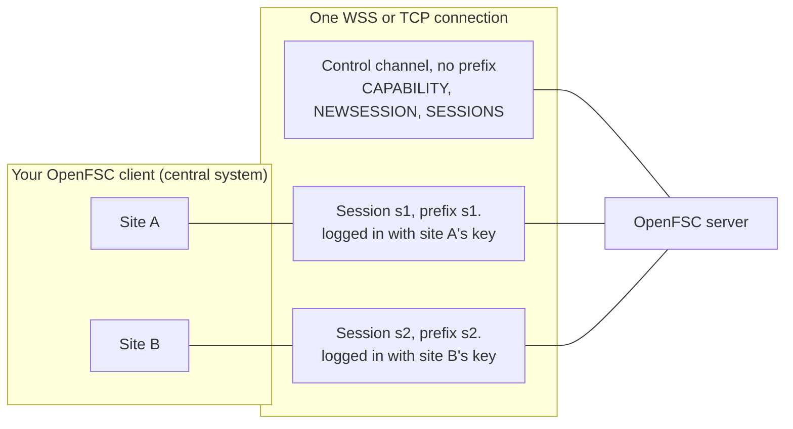
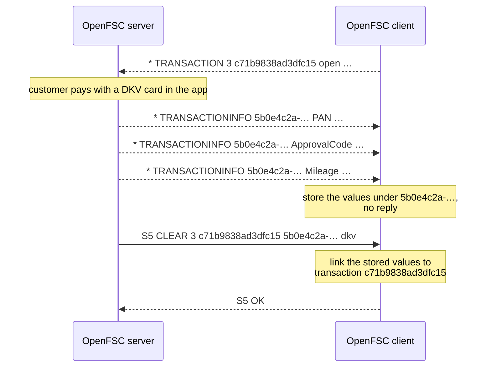

# OpenFSC Tutorial: From Zero to Hero
## Part 4: Advanced Topics, or: Power-Ups

This part covers optional extensions to the core protocol: Connection Multiplexing and Transaction Information. High Availability will be documented once its replacement is available. None of them is required for a working client, so feel free to skip what you don't need.

In this part:

- [Extension 1: Connection Multiplexing](#extension-1-connection-multiplexing)
- [Extension 2: Transaction Information](#extension-2-transaction-information)
- [High Availability](#high-availability)
- [Checklist](#checklist)

---

## Extension 1: Connection Multiplexing

### What Problem Does It Solve?

By default, each site has its own TCP/WebSocket connection to the OpenFSC server. This also applies if one piece of software connects **several sites** (e.g. a central system serving several sites). One connection per site is fine and the simplest approach. Boring is good here.

Connection Multiplexing lets you run several independent site sessions over **one shared connection**. Each session behaves exactly like a separate connection, with its own login and its own messages, but all sessions share one TCP/WebSocket connection.

> If you are connecting a single site, skip this extension entirely. Use a plain connection as described in Parts 1–3.



### How Sessions Work

A session is identified by a **SessionID**, a short alphanumeric string you choose (e.g. `s1`, `site42`). Once a session is created, every message belonging to that session is prefixed with `<sessionID>.` in the tag field:

```
s1.C1 PLAINAUTH 9eb56d5e-6563-430a-9d39-5ddf567e73d5 1d3b755d3bce8f09b4f8ff08dabf1796
s1.C1 OK
s1.* PUMP 1 free
```

Messages without a session prefix belong to the initial (non-multiplexed) connection. However, once you start using `NEWSESSION`, you must not log in on the initial connection. It is then only used to manage the sessions (control channel).

### Step-by-Step: Setting Up a Multiplexed Connection

**1. Open the connection and exchange CAPABILITY as normal (Part 1, Steps 1–3).**

Do not authenticate the initial connection. Check that the server announces `NEWSESSION` and `SESSIONS` in its capabilities. If it doesn't, multiplexing is not supported and you must use one connection per site.

**2. Create a session with NEWSESSION:**

```
C1 NEWSESSION s1
```

The server responds:
```
C1 OK
```

Optionally specify a priority (1 = highest). Priorities only matter if you connect the **same site** through several sessions for redundancy (see "Priority and Failover" below). For different sites, leave it out:

```
C1 NEWSESSION s1 1
```

Errors:
- `409`: SessionID already taken
- `410`: You already called `PLAINAUTH` on the initial connection, so multiplexing is no longer allowed

**3. Authenticate the session:**

Prefix all messages for this session with `<sessionID>.`:

```
s1.C2 PLAINAUTH 9eb56d5e-6563-430a-9d39-5ddf567e73d5 1d3b755d3bce8f09b4f8ff08dabf1796
```

The server responds:
```
s1.C2 OK
```

With multiplexing, `PLAINAUTH` has two additional errors:
- `409`: the session's priority is already taken by another session of the same site
- `410`: `PLAINAUTH` on the initial connection after `NEWSESSION`

**4. Proceed with the normal flow (pumps, prices, transactions) using the session prefix:**

```
s1.S1 PUMPS
s1.* PUMP 1 free
s1.* PUMP 2 in-use
s1.S1 OK
```

The server's request (`s1.S1 PUMPS`) carries the session prefix, so your client knows which site it is for and answers with the same prefix.

**5. Create additional sessions for more sites:**

```
C3 NEWSESSION s2
C3 OK
s2.C1 PLAINAUTH 4c1a7f20-8d3e-4b6a-9f15-2e7c0d9b3a61 7a9e2c4f6b8d0e1a3c5f7b9d2e4a6c8f
s2.C1 OK
```

Each site logs in with its own SiteAccessKey and Secret.

Each session is completely independent. A `HEARTBEAT` from the server for session `s1` will be tagged `s1.S6 HEARTBEAT ...` and must be answered with `s1.S6 BEAT ...` and `s1.S6 OK`.

**6. Closing a session:**

Send a `QUIT` on the session to close only that session, leaving others intact:

```
s1.* QUIT shutting down site 1
```

If the initial (unprefixed) connection is closed with `QUIT`, **all sessions on that connection are dropped without notice**.

### Listing Active Sessions

You can query which sessions are currently open on your connection:

```
C6 SESSIONS
```

The server responds with one `SESSION` notification per active session, then `OK`:

```
* SESSION s1 1 9eb56d5e-6563-430a-9d39-5ddf567e73d5
* SESSION s2 1 4c1a7f20-8d3e-4b6a-9f15-2e7c0d9b3a61
C6 OK
```

Each `SESSION` notification carries the SessionID, its priority, and optionally the SiteAccessKey it is authenticated with.

Note: `SESSIONS` only works on the initial (unprefixed) connection. Calling it with a session prefix returns `ERR 410`.

### Priority and Failover

If the same site connects through multiple sessions (e.g. as a redundancy mechanism), assign explicit priorities:

```
C1 NEWSESSION primary 1
C2 NEWSESSION backup 2
```

Both sessions log in with the same SiteAccessKey and Secret. The server communicates exclusively through the session with the highest priority (`1`). If that session disconnects, the server automatically switches to the next available session (`2`). This is also the basis for High Availability, which will be documented later.

### Reconnecting a Multiplexed Connection

If the shared TCP/WebSocket connection drops, **every session on it is gone**. Reconnect as described in Part 1, Step 10, with one connection-level retry loop and backoff, then rebuild the sessions:

1. Exchange `CAPABILITY` on the new connection. Don't log in on it: it stays the control channel.
2. Recreate each session with `NEWSESSION` (reusing the same SessionIDs and priorities is fine) and authenticate it with `PLAINAUTH`.
3. Answer the `PRODUCTS`, `PRICES`, `CLEAR` and `TRANSACTIONS` requests the server then sends on each session, exactly as for a standalone connection.

If a single session's `PLAINAUTH` fails with `ERR 401`, leave that site disconnected and alert an operator. Don't close the other sessions or the shared connection because of it.

For dead-connection detection, rely on transport-level keepalive (TCP keepalive or WebSocket pings) on the shared connection. By default, sessions are only sent a `HEARTBEAT` after about 10 minutes of silence (server-side configuration, not part of the spec), which is far too slow to be a useful liveness signal.

### CAPABILITY Update

Your own list does not change. Your client only checks that the server's list contains `NEWSESSION` and `SESSIONS` (see the [Reference](reference.md#capability-lists)).

---

## Extension 2: Transaction Information

### What Problem Does It Solve?

When a customer pays with a fleet card (for example PaymentMethod `dkv`), your POS may need some card details to complete the authorization or print a receipt: the PAN (Primary Account Number), an approval code or the vehicle's mileage. With the `TRANSACTIONINFO` extension, the server sends this sensitive data to your client right before it sends `CLEAR` or `UNLOCKPUMP`.

This only applies to payment methods that share card data. For PaymentMethod `pace`, no card data is shared: the server sends no `TRANSACTIONINFO`, only the `CLEAR` or `UNLOCKPUMP`.

> **This data is highly sensitive.** Eligibility to receive `TRANSACTIONINFO` must be agreed on commercially with PACE and is controlled in the OpenFSC backend. Even if your client announces the capability, the server may choose not to send it.

### How It Works

If both sides announce `TRANSACTIONINFO` in their `CAPABILITY`, the server will send one or more `TRANSACTIONINFO` notifications **before** the associated `CLEAR` (Post-Pay) or `UNLOCKPUMP` (Pre-Auth). Each notification carries a single key-value pair for the given `FSCTransactionID`.

### TRANSACTIONINFO Arguments

| Argument | Example | Notes |
|---|---|---|
| FSCTransactionID | `e2f74ef5-...` | The server-side transaction ID this info belongs to |
| Key | `PAN` | One of the defined keys (see table below) |
| Value | `92873498723498792384` | The value for the given key |

Defined key-value pairs:

| Key | Type | Description |
|---|---|---|
| `PAN` | string | Primary Account Number of the card used (19–21 digits) |
| `ApprovalCode` | number | 6-digit approval code (IFSF H2H) |
| `Mileage` | number | Odometer reading of the vehicle in kilometers, up to 7 digits. Defaults to `0` |

Each key arrives as a separate notification. There is no combined message: expect one `TRANSACTIONINFO` per key.

### Post-Pay Flow with TRANSACTIONINFO

The server sends the info notifications after the transaction is reported, and before the `CLEAR`:

```
→ Pump reaches ready-to-pay, client sends TRANSACTION

Server: S4 TRANSACTIONS 3
Client: * TRANSACTION 3 c71b9838ad3dfc15 open 0100 EUR 86.83 72.97 19.0 13.86 LTR 64.85 1.339
Client: S4 OK

Server: * TRANSACTIONINFO 5b0e4c2a-9d1f-4e8b-a6c3-2f7d1e9b8a04 PAN 92873498723498792384
Server: * TRANSACTIONINFO 5b0e4c2a-9d1f-4e8b-a6c3-2f7d1e9b8a04 ApprovalCode 643972
Server: * TRANSACTIONINFO 5b0e4c2a-9d1f-4e8b-a6c3-2f7d1e9b8a04 Mileage 176439

Server: S5 CLEAR 3 c71b9838ad3dfc15 5b0e4c2a-9d1f-4e8b-a6c3-2f7d1e9b8a04 dkv
Client: S5 OK
Client: * PUMP 3 free
```

If the customer pays with `pace` instead, the same transaction is cleared without any `TRANSACTIONINFO`, even though your client announced the capability:

```
Server: S4 TRANSACTIONS 3
Client: * TRANSACTION 3 c71b9838ad3dfc15 open 0100 EUR 86.83 72.97 19.0 13.86 LTR 64.85 1.339
Client: S4 OK

Server: S5 CLEAR 3 c71b9838ad3dfc15 5b0e4c2a-9d1f-4e8b-a6c3-2f7d1e9b8a04 pace
Client: S5 OK
Client: * PUMP 3 free
```

### Pre-Auth Flow with TRANSACTIONINFO

In Pre-Auth the server sends the info before `UNLOCKPUMP`, so your POS has the card data available before the fueling begins:

```
Server: * TRANSACTIONINFO 70644955-ef32-4d33-a88b-67b500a7c00d PAN 92873498723498792384
Server: * TRANSACTIONINFO 70644955-ef32-4d33-a88b-67b500a7c00d ApprovalCode 643972
Server: * TRANSACTIONINFO 70644955-ef32-4d33-a88b-67b500a7c00d Mileage 176439

Server: S2 UNLOCKPUMP 1 EUR 100.00 70644955-ef32-4d33-a88b-67b500a7c00d dkv
Client: S2 OK
Client: * PUMP 1 free
```

The same flow as a diagram (Post-Pay):



In Post-Pay, your client can only link the values to its own transaction when the `CLEAR` arrives, because the `CLEAR` is the first message that carries both IDs.

### Implementation Notes

- **`TRANSACTIONINFO` is a notification** (tag `*`), so you don't reply to it. Simply receive and store the key-value pairs, keyed by `FSCTransactionID`, so they are available when the subsequent `CLEAR` or `UNLOCKPUMP` arrives.
- **Each key arrives separately:** collect the key-value pairs per transaction as they come in.
- **The server may send none:** your client must work without `TRANSACTIONINFO` before a `CLEAR` or `UNLOCKPUMP`, even if the capability was announced. This is always the case for `pace`. Don't wait for it.

### CAPABILITY Update

Add `TRANSACTIONINFO` to your list, since your client handles that notification. The server announces it too (see the [Reference](reference.md#capability-lists)).

---

## High Availability

> **Not yet available.** The HA extension is currently being replaced with an alternative solution. It will be documented here once the new solution is available for general use.

---

## Checklist

Connection Multiplexing (only if you use it):
- [ ] Check that the server announces `NEWSESSION` and `SESSIONS` before using them.
- [ ] Never log in on the initial connection; use it only as control channel.
- [ ] Prefix every message of a session with `<sessionID>.`, including your answers to the server's requests.
- [ ] Log in each site with its own SiteAccessKey; use priorities only for several sessions of the same site.
- [ ] After losing the shared connection, recreate and log in all sessions; keep other sessions running if one site gets `ERR 401`.
- [ ] Use TCP keepalive or WebSocket pings on the shared connection.

Transaction Information (only if agreed with PACE):
- [ ] Announce `TRANSACTIONINFO` in your `CAPABILITY`.
- [ ] Store the key-value pairs per FSCTransactionID; don't reply to them.
- [ ] Work without them: the server sends none for `pace`, and may send none in other cases.
- [ ] Handle the card data as sensitive data (storage, logging, access).

---

## What's Next

>  **Next up:** That's it: you made it from zero to hero. The [Reference](reference.md) has the `CAPABILITY` lists, the product categories and all error codes in one place. Keep it close, you'll be back.

**Previous:** [Part 3: Transactions](part-3.md) · **Next:** [Reference](reference.md)
