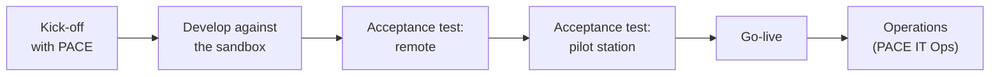

# OpenFSC Tutorial: From Zero to Hero
## Part 5: Testing & Go-Live, or: The Final Boss

Your client connects, reports and gets paid, at least on your desk. This part covers the way from "works on my machine" to "works at a real site": developing against the sandbox, the acceptance test with PACE, and what happens after go-live.

In this part:

- [The Road to Production](#the-road-to-production)
- [Step 1: Develop Against the Sandbox](#step-1-develop-against-the-sandbox)
- [Step 2: Run the Acceptance Test](#step-2-run-the-acceptance-test)
- [Step 3: Go Live](#step-3-go-live)
- [After Go-Live](#after-go-live)
- [Checklist](#checklist)

---

## The Road to Production

Every integration is a small project with a timeline, milestones, an acceptance test and a production rollout date. PACE guides you through it, from the kick-off until your first site is live. After go-live, PACE's IT Operations team takes over day-to-day operations.

---

## Step 1: Develop Against the Sandbox

You receive access to the sandbox (UAT) environment at the project kick-off: a SiteAccessKey and Secret for a test site, and the sandbox server address. Everything in Parts 1 to 4 can be built and tested there.

Nothing you do in the sandbox moves real money, so this is the place to try every edge case:

- Pull the network cable and check that your client reconnects with backoff (Part 1, Step 10).
- Restart your client in the middle of a transaction and answer the retried `CLEAR` (Part 3, Step 6).
- Send a malformed message on purpose and check that your client handles the `ERR 400` without crashing.

Better to find it here than on a Saturday morning at a busy site.

---

## Step 2: Run the Acceptance Test

Before go-live, you and PACE run through the real-world scenarios together. This happens in two rounds: first remotely against a test site, then at a pilot station with real fuelings.

A typical set of scenarios:

| Scenario | What we check |
|---|---|
| Post-Pay: fuel, pay in the app | Status sequence `free` → `in-use` → `ready-to-pay` → `free`, correct `TRANSACTION` amounts, `CLEAR` answered |
| Post-Pay: fuel, pay in the shop | The transaction disappears and is no longer reported |
| Pre-Auth (if supported): authorize, fuel, pay | `UNLOCKPUMP`, `TRANSACTION` with the FSCTransactionID, pump back to `locked` |
| Pre-Auth (if supported): authorize, don't fuel | `LOCKEDPUMP` with the right reason |
| Price change | The new price shows up in the app |
| Connection loss | Reconnect with backoff, retried `CLEAR` answered correctly |
| Reconciliation | Cleared transactions are marked "Clearance source: Connected Fueling" with the PaymentMethod |

>  **Tip:** Run through the checklists at the end of Parts 1 to 4 before the acceptance test. They cover almost everything we look at, and finding a gap on your own is a lot more relaxed than finding it together on a pilot station.

---

## Step 3: Go Live

After a successful acceptance test, you agree on the go-live date with PACE and receive the production credentials. Each site gets its own SiteAccessKey and Secret, so keep them per site in your configuration, never shared between sites.

The production server address differs from the sandbox. Make it configurable rather than hard-coded.

---

## After Go-Live

For questions and incidents, reach out to your PACE contact. For a quick answer, include:

- the site and pump,
- the time (with time zone),
- the SiteTransactionID and, if known, the FSCTransactionID,
- the relevant lines from your OpenFSC log, pasted exactly as they are.

>  **Recap:** Build and break things in the sandbox, pass the acceptance test remotely and at a pilot station, then go live with production credentials per site. That's it: you made it from zero to hero.

---

## Checklist

- [ ] Sandbox credentials and server address received at the kick-off
- [ ] Edge cases tested in the sandbox (reconnect, retried `CLEAR`, error codes)
- [ ] Checklists of Parts 1 to 4 done
- [ ] Acceptance test passed, remotely and at the pilot station
- [ ] Reconciliation lists checked
- [ ] Production credentials stored per site, server address configurable
- [ ] Go-live date agreed, PACE contact known

---

**Previous:** [Part 4: Advanced Topics](part-4.md) · **Next:** [Reference](reference.md)
